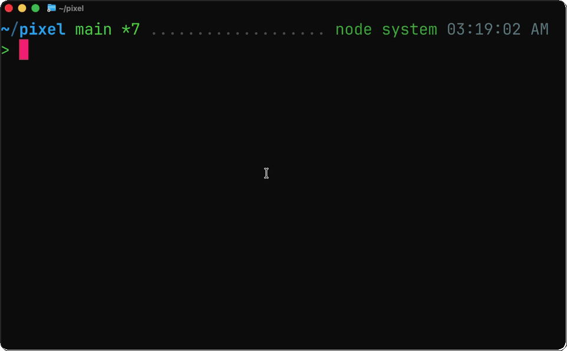

# Pixel

A library for building graphical applications that can run in the terminal

```
npm create @zenbu-labs/pixel@latest
```



## Notable features:

- A react API to use a rust based graphics engine that runs in the terminal
- WebView component that lets you render web content (based on top of a fork of electron)
- Support for proxying network requests made by the webview over an SSH connection
- Can be embedded inside other terminal applications
- Built in devtools (element inspector, profiler, log viewer)
- Cross platform

## Projects using pixel

- [terminal-browser](https://github.com/zenbu-labs/terminal-browser) - a browser inside the terminal
- [terminal-code](https://github.com/zenbu-labs/terminal-code) - vscode inside the terminal
# Docs

The documentation below is meant for humans that want to get a better conceptual understanding of the library. For detailed api documentation for your agents please reference [AGENT-DOCS](./AGENT-DOCS.md) and the [examples](./examples). 

## How does it work

Pixel allows for GUIs in the terminal by using a terminal feature to display raw pixels. You can use this feature through a standard known as the [kitty graphics protocol](https://sw.kovidgoyal.net/kitty/graphics-protocol/). This standard allows terminal programs to write instructions to stdout that tell the terminal:
- what pixels to display
- what region to display the pixels

Under the hood, the Pixel library is converting your UI definitions into kitty graphics instructions.

## Rendering types
Pixel has 2 ways to render UI:
1. the native react API
2. the webview component

These 2 options will give you significantly different results. The webview component lets you render full fidelity webapps, using the chromium browser engine under the hood. This means chromium speed and styling capabilities. 

The native react api lets you define your UI in react, but this gets interpreted by the pixel engine under the hood, which has less styling capabilities than css, and for heavy UI would be less efficient than chromium.

One downside to using the webview component is that it requires your app to spawn a new [renderer process](https://www.chromium.org/developers/design-documents/multi-process-architecture/#architectural-overview), which can easily consume hundreds of mb. While the pixel engine can use <10mb for a simple app.

The native UI and webview component can be useful if paired together since it allows you to embed webview components relative to the native UI elements. This allows you to implement a tabbed browser like [terminal-browser](https://github.com/zenbu-labs/terminal-browser)


## Multiplexers
Pixel apps will work in multiplexers, but it will have worse performance, and may loose capabilities, like receiving lower precision mouse position values.


This is because multiplexers rewrite the output of terminal programs in a way that:
- forces pixel to send graphics commands in a de-optimized format
- (might) drop requests for terminal features like precise mouse position reporting

[Herdr](https://herdr.dev/) and [tmux](https://github.com/tmux/tmux) are examples of multiplexers that have been tested to work with pixel.


## SSH
Pixel will work out of the box over SSH. In supported terminals, pixel will only send changed pixels over the SSH connection to minimmize bandwidth usage and improve performance. The reason this works is that pixel sends the pixel data directly through stdout, which is then sent over the SSH connection, and then interpreted by the terminal.

Pixel also comes with support for proxyiing webview network requests over an SSH connection. In this mode the UI would be running locally on your device. This is useful if you want to run a backend on a remote server for an application, but still want the UI to be very snappy and responsive. The best example of this is the pixel app [terminal-code](https://github.com/zenbu-labs/terminal-code), which allows users to install the vscode server on a remote machine, and then run the vscode UI locally through the terminal. Another example is [terminal-browser](https://github.com/zenbu-labs/terminal-browser), which lets you access localhost URLs on a remote machine through this SSH proxying feature.

## Questions
If you are curious how something works or behaves, I highly recommend asking your coding agent to clone this github repo and explore this package, then ask whatever questions you want!

